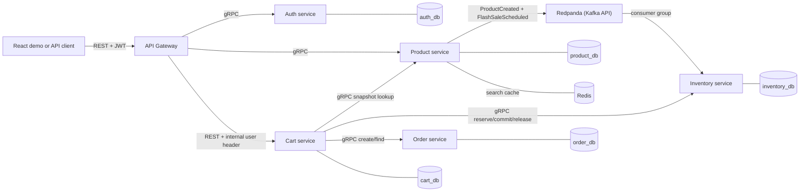
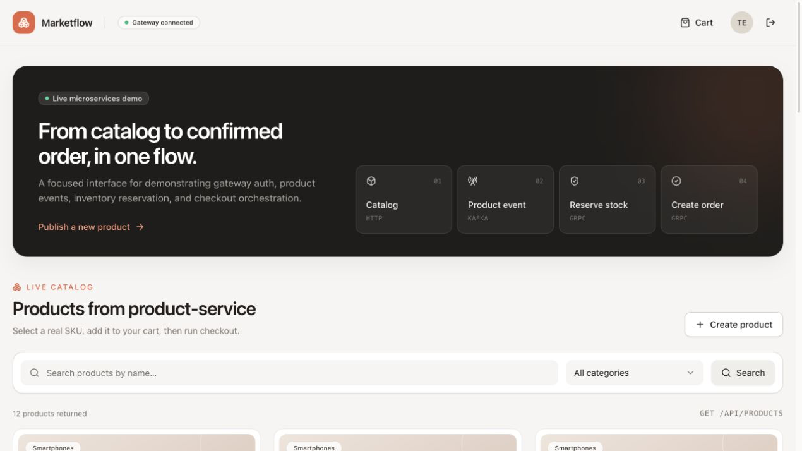
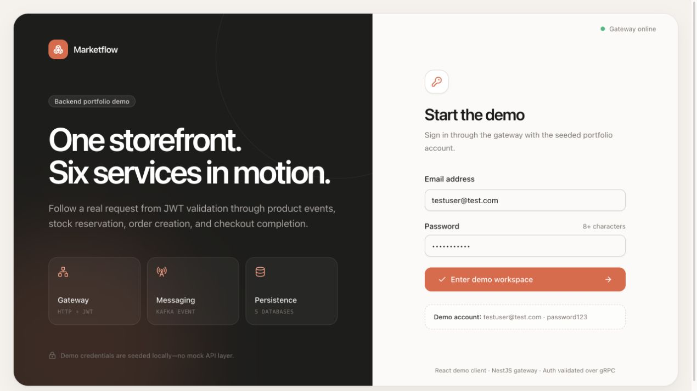
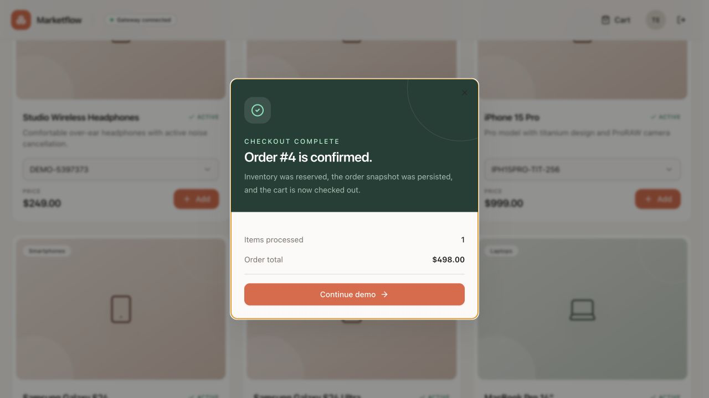

# E-commerce NestJS Microservices

A portfolio-oriented, Shopee-like commerce system built as a NestJS monorepo
with six separately runnable services. The scope is intentionally narrow: it
demonstrates authentication, catalog management, event-driven stock
initialization, cart snapshots, inventory reservation, and orchestrated checkout
without pretending to be a production-complete marketplace.

## Why This Project Exists

This repository is a portfolio backend project for demonstrating:

- NestJS monorepo structure with separately deployable services
- Clean Architecture boundaries inside each business service
- PostgreSQL database ownership per service
- gRPC service-to-service calls
- Kafka-compatible product events through Redpanda
- Redis cache-aside product search with short TTLs and database fallback
- Durable checkout recovery and compensation for definite failures
- Unit, contract, PostgreSQL/Kafka/gRPC integration, gateway E2E, and k6 verification

The implemented workflow is suitable for a controlled local demonstration and
has automated reliability, authorization, concurrency, and full-stack evidence.
Production deployment, service-to-service authentication, and observability
hardening remain intentionally incomplete; see [Current Limitations](#current-limitations).

## Architecture



The monorepo shares build tooling and transport contracts, not business data.
Every stateful service owns a separate PostgreSQL database and does not join
across service boundaries.

## Service Map

| Service             |             Port | Responsibility                                                      |
| ------------------- | ---------------: | ------------------------------------------------------------------- |
| `gateway`           |             4000 | Public HTTP entry point, auth/catalog/cart forwarding, Swagger docs |
| `auth-service`      | 4005 / gRPC 9005 | Users, login, JWT generation, token validation                      |
| `product-service`   | 4001 / gRPC 9001 | Catalog, flash sales, effective pricing, transactional outbox       |
| `inventory-service` | 4003 / gRPC 9003 | Normal/sale stock projections and reserve/commit/release            |
| `cart-service`      |             4002 | Durable carts, price snapshots, and checkout orchestration          |
| `order-service`     | 4004 / gRPC 9004 | Idempotent checkout orders and server-calculated totals             |

## Communication Map

| From    | To                  | Transport                                    | Why                                                     |
| ------- | ------------------- | -------------------------------------------- | ------------------------------------------------------- |
| Client  | Gateway             | REST/JSON                                    | Browser-friendly public API and Swagger documentation   |
| Gateway | Auth                | gRPC/Protobuf                                | Typed synchronous login and token-validation calls      |
| Gateway | Product             | gRPC/Protobuf                                | Typed internal catalog and flash-sale contracts         |
| Gateway | Cart                | REST/JSON                                    | Thin forwarding with trusted authenticated user context |
| Cart    | Product             | gRPC/Protobuf                                | Fetch a typed product/SKU pricing snapshot              |
| Cart    | Inventory and Order | gRPC/Protobuf                                | Typed synchronous checkout operations                   |
| Product | Inventory           | Kafka-compatible event with Protobuf payload | Decouple product persistence from stock initialization  |

Only the gateway is intended to be public. The downstream HTTP and gRPC
interfaces currently rely on network isolation rather than service-to-service
authentication.

## Main Business Flows

### Product to inventory

```text
create product
  -> commit product, SKU rows, and a pending ProductCreated outbox row
  -> return without waiting for Kafka
  -> leased background publisher sends the stored event and marks it published
  -> inventory consumes the event
  -> create stock and INITIALIZE transaction rows
  -> record the event ID and canonical payload hash as processed
```

Inventory treats a repeated event ID and matching payload as a successful no-op.
Reusing an event ID for different data is rejected. Product/outbox persistence
and inventory/processed-marker persistence each use one local transaction.
Operational inspection and failed-event replay are documented in the
[product outbox recovery runbook](docs/product-outbox-runbook.md).
The full sprint evidence and cross-service incident procedures are in the
[flash-sale verification report](docs/flash-sale-verification-report.md) and
[flash-sale operations runbook](docs/flash-sale-runbook.md).
For a source-linked architecture walkthrough and interview preparation, start
with the [interview guide](docs/interview-guide/00-index-and-reading-map.md).
For presentation outlines, speaker notes, demos, and prepared follow-up
questions, use the [engineering sharing pack](docs/slides/README.md).

### Authenticated checkout

```text
login through gateway
  -> gateway validates the JWT through auth-service gRPC
  -> gateway forwards the authenticated user ID to cart-service
  -> cart-service stores a product/SKU/price snapshot
  -> client starts checkout with a reusable idempotency key
  -> checkout reserves every inventory item in one local transaction
  -> order-service atomically creates the order and its item snapshots
  -> order-service calculates the total from the submitted cart snapshots
  -> checkout commits the inventory reservation
  -> cart-service marks the cart CHECKED_OUT
```

If order creation fails after reservation, `cart-service` calls
`ReleaseStock`. That is a compensating action, not an ACID transaction across
services. Ambiguous outcomes and failed compensation are recorded on the
checkout attempt. A leased background worker resumes the stored action with
bounded backoff, while the same checkout POST can still trigger an immediate
retry.

Each checkout intent requires a caller-generated UUID v4 `Idempotency-Key`.
Reuse that key only when retrying the same cart checkout:

- `200 OK` means the checkout completed. The response includes the stable
  `checkoutId`, `status: "COMPLETED"`, the original `orderId`, and the checked-out
  cart.
- `202 Accepted` means the non-terminal attempt was persisted with a recovery
  action. Poll `GET /api/checkouts/:checkoutId` or retry the same checkout POST
  with the same key.
- `400 Bad Request` means the checkout input is malformed or the stored attempt
  ended in a terminal failure.
- `409 Conflict` means the key belongs to another cart or the cart is already
  frozen by another checkout key.

An API retry actively resumes the stored action. The reconciliation worker also
claims due attempts in bounded batches, and expired leases can be reclaimed by
another cart-service instance.

### Flash-sale checkout

```text
schedule sale -> publish FlashSaleScheduled -> initialize sale stock
  -> cart freezes the effective SKU price -> reserve normal + sale stock
  -> create the idempotent order -> commit both counters -> complete cart
```

Inventory owns sale readiness, database-time windows, remaining allocation,
per-user limits, and normal stock. Regular and sale items may coexist in the
same atomic reservation.

## Implemented Guarantees

- Inventory validates the full stock request before applying changes.
- Conditional stock updates and a transaction prevent available quantity from
  going below zero during competing reservations.
- A `(cart_id, product_sku_id)` reservation key makes an identical reservation
  retry a no-op while it remains `RESERVED`.
- Successful orders commit their reservations atomically. Commit retries are
  no-ops, reduce only reserved quantity, and never restore available quantity.
- Product event IDs are stored in `processed_product_events`.
- Order and order-item insertion is atomic inside `order_db`.
- Cart items and order items retain product snapshots; there are no
  cross-database joins.
- The cart migration uses a partial unique index to enforce at most one
  `ACTIVE` cart per user.
- Checkout attempts persist an immutable item snapshot and use a unique
  `(user_id, idempotency_key)` identity.
- A unique checkout attempt per cart prevents two keys from checking out the
  same cart, and cart items are frozen after checkout starts.
- Orders use a unique checkout ID, allowing an ambiguous create response to be
  resolved without creating another order.
- Unknown order outcomes keep inventory reserved and persist `CHECK_ORDER`;
  retries query the order before issuing another idempotent create request.

These guarantees rely on local transactions and replay-safe coordination; they
do not create a distributed ACID transaction.

## Current API Surface

### Gateway

- `POST /api/auth/login`
- `GET /api/auth/validate`
- `GET /api/categories`
- `POST /api/categories`
- `GET /api/products`
- `POST /api/products`
- `PUT /api/products/:productId`
- `DELETE /api/products/:productId`
- `GET /api/flash-sales?status=active|upcoming`
- `GET /api/flash-sales/:saleId`
- `POST /api/flash-sales`
- `PUT /api/flash-sales/:saleId`
- `POST /api/flash-sales/:saleId/cancel`
- `POST /api/flash-sales/:saleId/schedule`
- `GET /api/carts/me`
- `POST /api/cart-items`
- `PUT /api/cart-items/:cartItemId`
- `DELETE /api/cart-items/:cartItemId`
- `POST /api/carts/:cartId/checkout` (requires a UUID v4 `Idempotency-Key`
  header; returns `200` when complete or `202` when recovery is pending)
- `GET /api/checkouts/:checkoutId` (returns only the authenticated owner's
  durable checkout status, cart and order IDs, and attempt timestamps)
- Swagger UI: `GET /docs`

All `/api` routes listed above except `POST /api/auth/login` require a bearer
token. The public `/health`, `/hello`, and `/docs` surfaces do not. The gateway
validates tokens and roles through auth-service gRPC. Product and flash-sale
mutations require `ADMIN`; authenticated users may use the read endpoints. For
cart routes, the gateway passes the authenticated user ID to cart-service
through the internal `x-user-id` header.

### gRPC Contracts

- Auth: `Login`, `ValidateToken`
- Product: catalog, flash-sale, and effective-price snapshot operations
- Inventory: `ReserveStock`, `CommitStock`, `ReleaseStock`
- Order: `CreateOrder`, `GetOrderByCheckoutId`

Shared protobuf files live in `libs/proto`.

## Technology Choices

| Technology                    | Use in this project                                                   | Main trade-off                                                                   |
| ----------------------------- | --------------------------------------------------------------------- | -------------------------------------------------------------------------------- |
| NestJS + TypeScript           | Modules, dependency injection, DTO validation, HTTP and gRPC adapters | Productive structure, with more framework ceremony than a small service requires |
| Prisma + PostgreSQL           | Separate schema and database per stateful service                     | Strong local transactions, but no cross-service transaction or join              |
| REST/JSON                     | Public gateway and gateway-to-cart forwarding                         | Browser-friendly; weaker contract enforcement than Protobuf                      |
| gRPC + Protobuf               | Auth, product, inventory, and order service calls                      | Typed and compact; harder to debug manually and currently lacks deadlines        |
| Redpanda/Kafka API + Protobuf | Asynchronous product and flash-sale projections                       | Decouples inventory, while at-least-once delivery requires idempotent consumers  |
| JWT + bcrypt                  | Authentication, password verification, and gateway role enforcement   | Stateless tokens scale well, but token revocation is not implemented             |
| React + Vite                  | Focused demo UI                                                       | Improves presentation but is not the architectural focus                         |

## Local Setup

Prerequisites:

- Node.js 22.19.0 or newer
- npm 10 or newer
- Docker with the Compose plugin

Install dependencies:

```bash
npm install
```

Copy environment variables:

```bash
cp .env.example .env
```

Start local infrastructure:

```bash
docker compose up -d
```

Docker Compose starts the five PostgreSQL databases, Redpanda, and Redis. The six
application services run on the host; the checked-in application `Dockerfile`
is not currently a verified production deployment path.

Generate Prisma clients:

```bash
npm run prisma:auth:generate
npm run prisma:product:generate
npm run prisma:inventory:generate
npm run prisma:cart:generate
npm run prisma:order:generate
```

Run migrations when the matching databases are available:

```bash
npm run prisma:auth:migrate
npm run prisma:product:migrate
npm run prisma:inventory:migrate
npm run prisma:cart:migrate
npm run prisma:order:migrate
```

For a reproducible local setup that applies existing migrations without
creating new ones, use the matching `prisma:*:deploy` scripts instead.

Seed available demo data:

```bash
npm run prisma:auth:seed
npm run prisma:product:seed
npm run prisma:inventory:seed
```

Or seed all demo data in one command:

```bash
npm run demo:seed
```

## Running Services

Run services in separate terminals:

```bash
npm run start:dev:gateway
npm run start:dev:auth
npm run start:dev:product
npm run start:dev:inventory
npm run start:dev:cart
npm run start:dev:order
```

## Quality Checks

```bash
npm run build:all
npm run lint
npm run test:unit
npm run test:contract
npm run test:integration
npm run test:e2e
npm run test:all
npm run frontend:build
npm run frontend:lint
```

Tests run in four separately configured lanes. Colocated `*.spec.ts` files are
unit tests and need no Docker. `*.contract.spec.ts` verifies transport contracts.
`*.integration.spec.ts` runs serially against disposable PostgreSQL, Redis, and Redpanda containers.
`tests/e2e/**/*.e2e.spec.ts` owns full-stack workflows with PostgreSQL, Redis, Redpanda,
HTTP, and gRPC. Every runner prints its lane and only discovers its own naming
pattern. See [tests/README.md](tests/README.md) for the conventions.

## Continuous Integration

GitHub Actions runs four required checks from a fresh checkout:

- `static` installs with `npm ci`, generates every Prisma client, lints and
  builds all services, then installs, lints, and builds the frontend.
- `unit-contract` runs unit coverage and contract tests and uploads JUnit and
  HTML/JSON coverage artifacts.
- `integration` starts isolated PostgreSQL, Redis, and Redpanda containers,
  applies real migrations, and runs repository, cache, Kafka, and gRPC tests.
- `e2e` starts the six built services and their infrastructure, runs the gateway
  workflows, and then runs only the short k6 smoke profile.

Integration and E2E resources use a run-specific suffix and are removed by
shell traps on success or failure. Failed jobs upload service and infrastructure
logs. CI supplies database URLs and a test-only JWT secret through environment
variables, so no manually created `.env` file is required.

Configure `main` branch protection to require the `static`, `unit-contract`,
`integration`, and `e2e` checks. The concurrency, retry-storm, and read-heavy
load profiles remain explicit local or dedicated-environment commands; normal
pull requests run only `load:flash-sale:smoke`.

Flash-sale delivery uses `FLASH_SALE_EVENTS_TOPIC` and
`INVENTORY_FLASH_SALE_KAFKA_GROUP_ID`. Product outbox polling uses
`PRODUCT_OUTBOX_POLL_INTERVAL_MS`, `PRODUCT_OUTBOX_BATCH_SIZE`,
`PRODUCT_OUTBOX_LEASE_MS`, `PRODUCT_OUTBOX_SHUTDOWN_TIMEOUT_MS`, and
`PRODUCT_OUTBOX_MAX_ATTEMPTS`. Checkout recovery uses the corresponding
`CHECKOUT_RECONCILIATION_*` settings; `.env.example` contains the local defaults.

## Basic Local Verification

After the services are running, check the basic HTTP surfaces:

```bash
curl http://localhost:4000/health
curl http://localhost:4001/health
curl http://localhost:4002/health
curl http://localhost:4003/health
curl http://localhost:4004/health
curl http://localhost:4005/health
```

Open gateway Swagger docs:

```text
http://localhost:4000/docs
```

## Redis Product Search Cache

`GET /api/products` uses a cache-aside lookup inside product-service. A valid
hit skips the PostgreSQL search; a miss queries PostgreSQL and stores the result
for 30 seconds. Name and category filters have separate hashed keys under
`product-service:catalog-search:v1:`. Empty results are cached too.

| Variable | Default | Purpose |
| --- | --- | --- |
| `PRODUCT_CACHE_ENABLED` | `false` | Enable caching; `.env.example` sets `true` for the local demo |
| `PRODUCT_REDIS_URL` | Required when enabled | Local example: `redis://127.0.0.1:6379` |
| `PRODUCT_CACHE_TTL_SECONDS` | `30` | Expiration from cache population; hits do not renew it |
| `PRODUCT_CACHE_TIMEOUT_MS` | `100` | Deadline for each Redis operation |
| `PRODUCT_CACHE_DEBUG` | `false` | Log hit, miss, fill, and bypass events |

Redis is optional: disconnected or timed-out lookups fall back to PostgreSQL,
failed writes do not fail requests, and the client reconnects in the background.
The product-service health endpoint remains a liveness check. Disable caching
and restart product-service to return to database-only reads.

The 100 ms default is a per-command waiting deadline, not an end-to-end HTTP
deadline. A cache miss can wait for both a GET and a SET, in addition to the
database query. A failed GET skips population for that request. A command
already sent to Redis may still complete after its caller times out; the client
cancels queued commands and bounds its pending command queue to 1,000 entries.
Database failures on a miss still fail the request; Redis is not a database
failover mechanism.

Product edits and deletion do not invalidate cached searches. Results can be
stale until expiry, including missing newly created products. The TTL starts
when a result is cached, so an in-flight query can populate an older result after
a concurrent write; this is not a strict 30-second post-write freshness guarantee.
Cart SKU snapshots, effective flash-sale prices, inventory, checkout, categories,
and authentication use their existing paths. A cache hit still requires gateway
authentication.

Search remains unpaginated. Results over 256 KiB bypass storage. Local Redis
has a 128 MiB limit and evicts least-recently-used keys; persistence is disabled.
Concurrent misses may duplicate database reads. There is no distributed lock,
background refresh, local second-level cache, or write invalidation.

### Repeatable cache demo

Complete the local setup and seed data above. If `.env` already exists, add the
five cache settings from `.env.example` and set `PRODUCT_CACHE_DEBUG=true`.
Restart product-service, or start it in its own terminal:

```bash
docker compose up -d redis
PRODUCT_CACHE_ENABLED=true PRODUCT_REDIS_URL=redis://127.0.0.1:6379 \
  PRODUCT_CACHE_TTL_SECONDS=30 PRODUCT_CACHE_TIMEOUT_MS=100 \
  PRODUCT_CACHE_DEBUG=true npm run start:dev:product
```

With the other services running, use a second terminal. Adjust `GATEWAY_URL`
if the demo launcher selected another port. These credentials belong to the
local seeded administrator; the token is captured without printing it.

```bash
GATEWAY_URL=http://localhost:4000
CACHE_DEMO_TOKEN="$(curl -fsS "$GATEWAY_URL/api/auth/login" \
  -H 'Content-Type: application/json' \
  -d '{"email":"testuser@test.com","password":"password123"}' \
  | node -pe 'JSON.parse(require("node:fs").readFileSync(0, "utf8")).token')"

# Derive and clear only the key used by this demo, so the first read is a miss.
CACHE_DEMO_KEY="$(node -e '
const hash = require("node:crypto").createHash("sha256")
  .update(JSON.stringify({name: "iPhone", categoryId: null})).digest("hex");
process.stdout.write("product-service:catalog-search:v1:" + hash);
')"
docker compose exec -T redis redis-cli DEL "$CACHE_DEMO_KEY"

# First request: product_cache_miss followed by product_cache_fill.
curl -fsS "$GATEWAY_URL/api/products?name=iPhone" -H "Authorization: Bearer $CACHE_DEMO_TOKEN"
# Repeat immediately: product_cache_hit, with the same response.
curl -fsS "$GATEWAY_URL/api/products?name=iPhone" -H "Authorization: Bearer $CACHE_DEMO_TOKEN"
docker compose exec -T redis redis-cli TTL "$CACHE_DEMO_KEY"

# Expiry: the next request misses and fills again.
sleep 31
curl -fsS "$GATEWAY_URL/api/products?name=iPhone" -H "Authorization: Bearer $CACHE_DEMO_TOKEN"

# Outage: still HTTP 200, served from PostgreSQL.
docker compose stop redis
curl -fsS "$GATEWAY_URL/api/products?name=iPhone" -H "Authorization: Bearer $CACHE_DEMO_TOKEN"
docker compose start redis
# After the connection-recovered log, repeat twice to see fill then hit.
curl -fsS "$GATEWAY_URL/api/products?name=iPhone" -H "Authorization: Bearer $CACHE_DEMO_TOKEN"
curl -fsS "$GATEWAY_URL/api/products?name=iPhone" -H "Authorization: Bearer $CACHE_DEMO_TOKEN"
unset CACHE_DEMO_TOKEN
```

The integration suite uses real Redis and PostgreSQL with a counted repository
call to prove that two identical reads perform one database search. It also
checks reuse across independent Redis clients, filter isolation, expiry,
corrupt payloads, paused-server read/write deadlines, and restart recovery.
Gateway E2E verifies authentication, stale edits, deletion, outage fallback, and
startup without Redis. Run `npm run test:integration` and `npm run test:e2e`;
both runners create isolated Redis containers and override local cache settings.
HTTP latency alone is not evidence of database-query savings.

For a focused check, run:

```bash
npm run test:integration -- apps/product-service/src/catalog/infrastructure/cache/redis-product-search.cache.integration.spec.ts
npm run test:e2e -- -t 'caches authenticated catalog searches'
```

If no cache events appear, confirm the settings are in the environment used by
product-service and restart that process; editing `.env.example` does not update
an existing `.env`. Enable `PRODUCT_CACHE_DEBUG` to see `not_ready`, `read_failed`,
`write_failed`, or `oversized` bypass reasons. `TTL` returning `-2` means the key
is absent; `-1` means it has no expiration and was not written normally by this
adapter. Inspect or delete only the exact demo key, never flush the shared Redis
instance. Disable debug logging after the demo.

Interview summary: “I cached repeated product searches using Redis cache-aside.
PostgreSQL stays authoritative. I accepted short-lived stale browse results and
kept stock, checkout, and effective pricing outside the cache. Redis failure
returns reads to PostgreSQL, and integration tests prove cache reuse and recovery.”

## Demo Checkout Flow

Use the gateway-first demo after infrastructure, migrations, seeds, and services
are running:

```bash
npm run demo:seed
scripts/demo-checkout.sh
```

The script logs in as the seeded user, reads products through the gateway, adds a
seeded SKU to the authenticated user's cart, reads the active cart, and checks
out. It generates one UUID v4 `Idempotency-Key` for the checkout intent and
prints both the checkout and order IDs.

To reproduce the replay, conflict, and lost-order-response sprint scenarios,
start the demo with its explicit development-only fault enabled, then run the
verification in another terminal:

```bash
ORDER_DEMO_LOST_RESPONSE_AFTER=1 npm run demo
npm run verify:checkout-sprint
```

The verification resets local cart, order, and reservation transaction data,
then asserts the HTTP responses and physical order/reservation row counts. The
fault is disabled when `NODE_ENV=production`.

Verify the cart, order, and inventory migrations against empty, populated
legacy, and current local databases with:

```bash
npm run verify:migrations
```

Run the PostgreSQL repository and concurrency tests with:

```bash
npm run test:integration
```

Run product creation during a broker outage, duplicate Kafka delivery,
flash-sale projection, sale checkout, expiry, allocation races, and per-user
limits with:

```bash
npm run test:e2e
```

Run the short flash-sale k6 smoke profile against an isolated running stack with:

```bash
npm run load:smoke
```

Run the 100-buyer burst profile with `npm run load:flash-sale`. For three trials
each at 100, 500, and 1,000 buyers on a disposable stack, run
`npm run load:flash-sale:benchmark`. Set `LOAD_CONNECTION_MODE=warm` for a
separate experiment over established keep-alive connections. The comparison retains throughput, latency,
failed thresholds, and database verification; it measures finite bursts rather
than sustained production capacity.

The concurrency, retry-storm, and read-heavy profiles are intended for local or
dedicated environments. They prepare authentication tokens and carts before
measurement and always run cross-database invariants afterward. Configuration,
thresholds, and machine-specific Markdown baselines are documented in
[tests/load/README.md](tests/load/README.md). Local results are development
baselines, not production-capacity claims. See the [measured 100/500/1,000-buyer
results](docs/flash-sale-verification-report.md#october-2026-expanded-load-evidence),
including failed latency targets and cold-connection limits.

The E2E command briefly stops and restarts its disposable Redpanda container.
It uses unique Kafka topics, disposable PostgreSQL databases, dynamically
allocated application ports, and bounded state polling. Topics, databases,
processes, and temporary files are removed whether the command passes or fails.

The sale verification creates and schedules real sales, waits with bounded
database polling for Kafka projections, and drives cart, inventory, order, and
product services together. It checks the happy path, expiry, broker delay,
duplicate delivery, concurrent sold-out contention, the one-per-user rule, and
recovery when an order commits before its gRPC response is lost.

Example sale creation and scheduling requests through the gateway:

```bash
curl -X POST http://localhost:4000/api/flash-sales \
  -H 'Authorization: Bearer <admin-token>' \
  -H 'Content-Type: application/json' \
  -d '{"name":"Weekend sale","startsAt":"2026-09-26T03:00:00.000Z","endsAt":"2026-09-26T05:00:00.000Z","items":[{"productSkuId":1001,"salePrice":19.90,"stockLimit":5,"maxQuantityPerUser":1}]}'

curl -X POST http://localhost:4000/api/flash-sales/10/schedule \
  -H 'Authorization: Bearer <admin-token>'
```

Example sale cart and checkout requests against `cart-service`:

```bash
curl -X POST http://localhost:4002/api/cart-items \
  -H 'Content-Type: application/json' -H 'x-user-id: 10' \
  -d '{"productSkuId":1001,"quantity":1}'

curl -X POST http://localhost:4002/api/carts/20/checkout \
  -H 'x-user-id: 10' \
  -H 'Idempotency-Key: 550e8400-e29b-41d4-a716-446655440000'
```

Definite sale failures return HTTP `400` with `FLASH_SALE_NOT_READY`,
`FLASH_SALE_NOT_ACTIVE`, `FLASH_SALE_ENDED`, `FLASH_SALE_SOLD_OUT`, or
`FLASH_SALE_LIMIT_REACHED`. An unknown transport outcome returns `202`, stores
`RESERVE_STOCK`, and does not call order-service.

Seeded demo credentials:

```text
email: testuser@test.com
password: password123
```

## Frontend Demo

The repository includes a focused React + Vite demo client in `frontend/`. It
uses shadcn/ui components, talks only to the public gateway, and covers login,
catalog search, product event publishing, cart updates, and checkout UI.

### One-command launch

After the initial `npm install`, start the complete local demo from the repository
root:

```bash
npm run demo
```

The command starts Docker infrastructure, prepares and seeds the databases,
builds and launches all six services, and starts the React frontend. It prints the
frontend URL and seeded credentials when every health check passes. If ports 4000
or 5173 are already occupied, it automatically selects an available demo port.

Press `Ctrl+C` to stop the application processes. The Docker containers remain
running for faster restarts; stop them separately with `docker compose down`.

Runtime service logs are written to `.demo-logs/`.

You can override the automatically selected public ports when needed:

```bash
DEMO_GATEWAY_PORT=4100 DEMO_FRONTEND_PORT=5174 npm run demo
```

`scripts/demo-checkout.sh` is the API-only smoke test and assumes the backend is
already running. Set `DEMO_IDEMPOTENCY_KEY` to replay a specific checkout
intent.

### Manual launch

After the backend services are running, start it from the repository root:

```bash
npm run frontend:install
npm run frontend:dev
```

Open `http://localhost:5173`. The seeded credentials are prefilled for a smooth
screen recording.



<details>
<summary>More demo screens</summary>

### Gateway login



### Successful distributed checkout



</details>

For a short portfolio video, record this path: sign in → publish a product → add
its SKU to cart → allow inventory to consume the event → change quantity →
confirm checkout → hold on the created-order receipt.
See [`frontend/README.md`](frontend/README.md) for gateway proxy configuration
and the complete demo path.

## Architecture Notes

- Controllers are thin and map transport input to application commands.
- Use cases contain business flow and depend on ports, not Prisma, Kafka, or gRPC clients.
- Infrastructure adapters implement repository and service ports.
- Each business service owns its own Prisma schema and database.
- `libs/common` is reserved for technical helpers only, not shared business logic.

## Technical Decisions And Trade-offs

- **Orchestrated checkout:** `cart-service` owns the workflow because it already
  owns the user's checkout intent. This is easy to follow in an interview, but
  it couples cart availability to inventory and order availability.
- **Compensation instead of distributed ACID:** PostgreSQL transactions protect
  each service locally. Cross-service failure is handled by releasing stock
  after an order error. This keeps the design realistic without adding 2PC.
- **Snapshots:** cart and order rows retain name, SKU code, image, and price.
  This avoids cross-service reads and preserves what the user saw. The current
  order total is calculated server-side from the cart-provided snapshot; it is
  not repriced against the live catalog during checkout.
- **Central token validation:** the gateway asks auth-service to validate every
  bearer token. That centralizes the trust decision but adds latency and makes
  auth-service a synchronous dependency for all protected routes.
- **Thin gateway:** it validates and forwards; catalog, cart, stock, and order
  rules stay in their owning services.

## Current Limitations

- Reconciliation depends on a caller retrying the same checkout key; there is no
  worker to process pending attempts automatically after a restart.
- Committed and released reservations do not expire or get archived yet.
- Scheduled sales cannot yet be cancelled, and there is no post-campaign
  allocation cleanup job.
- Internal services trust direct network access and `cart-service` trusts the
  gateway-provided `x-user-id` header. There is no mTLS or service identity.
- Product updates/deletes do not publish inventory synchronization events.
- Service clients do not define explicit deadlines, retries, circuit breakers,
  or backoff policies.
- Health endpoints are process liveness responses; they do not verify database,
  broker, or downstream readiness.
- Observability is limited to Nest logs and basic gateway request timing. There
  are no correlation IDs, metrics, distributed traces, or alerting.
- The application `Dockerfile` and production deployment workflow are not
  complete; Docker Compose is currently for local infrastructure only.

Registration, payment processing, shipping, order history, cancellation,
search infrastructure beyond PostgreSQL filtering, caching beyond product search,
Kubernetes, service mesh, and multi-region
operation are intentionally outside the current demo scope.

## Recommended Next Work

1. Add metrics and read-only administrator visibility for checkout recovery,
   sale allocation, outbox backlog age, and failed events.
2. Add correlation/trace IDs and uniform HTTP/gRPC deadlines.
3. Add service-to-service authentication and complete OS-signal shutdown wiring
   for every worker-owning service.
4. Produce and verify reproducible deployment images and readiness checks.

See the [Development Guide](docs/development-guide.md) for contribution rules
and the [Roadmap and Handoff](docs/roadmap.md) for detailed priorities,
acceptance criteria, and reusable context for future prompts.
